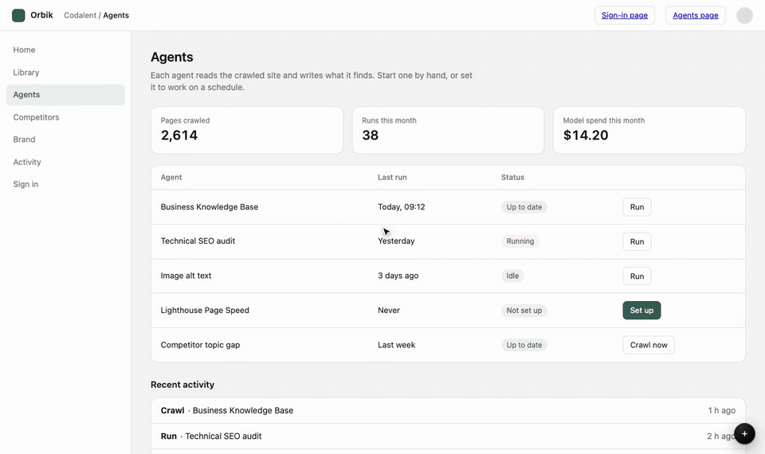

# devbar

A small dev toolbar for any web app. A dot sits in the corner of your app; click it to log a
**task, bug or idea** while you are looking at the problem, with a screenshot, the page, the
browser, recent console errors and the element you point at, or a **recording of your screen and voice** while you walk through what to fix.
Each item becomes a **Markdown file** that you, your team and your AI coding agent can pick up.



<sub>Logging a bug on the demo page, picking the broken button, saving it as `.devbar/open/009-….md`, then
moving it to Ready on the board. [Watch as MP4](docs/demo.mp4).</sub>

## Two ways to use it

| | **No backend** | **With a backend** |
|---|---|---|
| Setup | add the widget to your app | add the widget and set `server` to your backend's URL |
| Save | downloads the item: a `.md` file, or a `.zip` when it has a screenshot | sends it to the backend, which stores it (the Node backend writes it into `.devbar/` in your repository) |
| Board | none | a kanban board of every item, with drag-and-drop and editing |
| Good for | trying it, a quick bug report, a site with no backend you control | day-to-day use by a team or an AI agent |

The only difference in setup is **one setting, `server`**. Leave it out and devbar downloads; set it
and devbar talks to that backend.

- [Quick start: no backend](#quick-start-no-backend)
- [Connect a backend](#connect-a-backend): [the local server](#1-the-local-server), [inside your Node server](#2-inside-your-own-node-server), [any other language](#3-your-own-backend-in-any-language)
- [Using it](#using-it) · [The files](#the-files) · [Working with AI coding agents](#working-with-ai-coding-agents) · [Configuration](#configuration)
- [The REST API](#the-rest-api) (for writing your own backend)
- [Security](#security) · [Upgrading from 0.3](#upgrading-from-03)

## Quick start: no backend

Install the package:

```sh
npm install --save-dev @codalent/devbar
```

Then add the widget in **one** of these ways.

**React or Next.js**, once in the root layout:

```tsx
import { DevBar } from "@codalent/devbar/react";

<DevBar />;
```

**Any bundler** (Vite, webpack, …), in your browser code:

```js
import { mount } from "@codalent/devbar/client";

mount();
```

**A script tag**, with no build step. Load the file from a CDN, or copy
`node_modules/@codalent/devbar/dist/devbar.js` into your static folder and load it from there:

```html
<script src="https://unpkg.com/@codalent/devbar@0.4/dist/devbar.js"></script>
```

That's all. Click the dot, fill in the form, press **Save**, and the browser downloads the item.

### What the download looks like

Without a screenshot, it is one Markdown file named after the type and title:

```
bug-login-button-overlaps-logo.md
```

With a screenshot or a screen recording, it is a zip with the same layout as the `.devbar/` folder,
so the Markdown's links work wherever you unzip it, and unzipping it into `.devbar/` puts it on the
board later:

```
bug-login-button-overlaps-logo.zip
  open/bug-login-button-overlaps-logo.md
  assets/bug-login-button-overlaps-logo-screenshot.png
  assets/bug-login-button-overlaps-logo-recording.webm     (when you recorded one)
```

The Markdown is the same as a backend writes ([see The files](#the-files)), except that it has no `id`.

### When it shows

The React component and `mount()` show the toolbar only in development builds
(`process.env.NODE_ENV === "development"`), so a production build renders nothing and loads nothing.
To decide yourself, pass `enabled`: `<DevBar enabled={…} />` or `mount({ enabled: … })`. The script
tag always shows; add `data-enabled="false"` to turn it off, or leave the tag out of production pages.

## Connect a backend

Give the widget your backend's URL. That is the whole client-side setup:

| How you load the widget | Set the backend |
|---|---|
| React | `<DevBar server="http://127.0.0.1:4711" />` |
| `mount()` | `mount({ server: "http://127.0.0.1:4711" })` |
| Script tag | `<script src="…/devbar.js" data-server="http://127.0.0.1:4711"></script>` |

The URL is the backend's base: the widget calls `<server>/api/items` and the other
[REST endpoints](#the-rest-api). It can be a full URL (`https://api.example.com/devbar`) or a path on
your own site (`/devbar`).

If the backend has a shared key, give the widget the same key: `<DevBar apiKey="…" />`,
`mount({ key: "…" })` or `data-key="…"` on the script tag.

There are three kinds of backend.

### 1. The local server

The quickest. It runs on your machine, stores items as files in `.devbar/` in your repository, and
serves the widget.

```sh
npx @codalent/devbar init   # makes .devbar/ with five status folders and config.json
npx @codalent/devbar        # starts the server on http://127.0.0.1:4711
```

Then load the widget **from the server**. A script tag loaded from a devbar backend connects to that
backend by itself, with no `data-server`:

```html
<script src="http://127.0.0.1:4711/devbar.js"></script>
```

Or, in React, `<DevBar server="http://127.0.0.1:4711" />`. In Next.js without installing the package,
add the script tag to the root layout:

```tsx
{process.env.NODE_ENV === "development" && <script src="http://127.0.0.1:4711/devbar.js" async />}
```

Put the script in `<head>`, so the console switch catches errors from the moment the page starts.
`<DevBar />` starts listening a moment later, once its chunk has loaded after React's first render.

Open `http://127.0.0.1:4711/demo` to try it on a sample page. `/demo?standalone=1` shows the
no-backend mode, and `/demo?reset=1` adds an aggressive global CSS reset to show that the toolbar is
unaffected by the page's CSS.

The local server only accepts pages on `localhost`. See [Security](#security).

### 2. Inside your own Node server

Mount devbar in the Node server your app already has (Express, Connect or plain `http`) instead of
running a separate process. It stores the same files.

```js
import { createDevbar } from "@codalent/devbar/server";

if (process.env.DEVBAR === "on") {
  const devbar = await createDevbar({
    dir: new URL("../.devbar", import.meta.url).pathname, // the data folder
    key: process.env.DEVBAR_KEY, // optional: only requests that carry it get in
  });
  app.use("/devbar", devbar.handle); // before a JSON body parser, or exempt /devbar from it
}
```

Then point the widget at it:

```js
mount({ server: "https://api.example.dev/devbar", key: savedKey });
// or <DevBar server="https://api.example.dev/devbar" apiKey={savedKey} />
// or <script src="https://api.example.dev/devbar/devbar.js"></script>   (connects to it by itself)
```

What `createDevbar` gives you:

- `handle(req, res, next)` answers the [REST endpoints](#the-rest-api) relative to where you mount
  it, plus `/devbar.js`, and calls `next` for any other path.
- It reads the request body itself, because an item with a screenshot is a few megabytes. A body that
  a parser already read is used as it is. A screen recording arrives as raw video and can be hundreds
  of megabytes, so keep JSON and body-size parsers off devbar's path.
- It adds **no CORS headers and no access rules**: your server's own apply. A page on another origin
  needs that origin allowed, with the `Content-Type` and `X-Devbar-Key` headers.
- Screenshots and the script are sent with `Cross-Origin-Resource-Policy: cross-origin`, so they load
  across origins whatever your server's defaults.
- Options: `dir` (required), `key`, `log` (a function for its log lines) and `pages: true` (also serve
  the landing and demo pages, which only the local server does by default).
- `devbar.close()` stops watching the folder and ends open event streams.

### 3. Your own backend, in any language

The widget only speaks HTTP and JSON, so a backend can be written in Python, Go, Ruby or anything else,
and can store items anywhere: files, a database, an issue tracker. Implement the endpoints in
[The REST API](#the-rest-api) and point `server` at it. devbar ships only the Node backend.

A backend that only needs to receive items (say, to forward them to Slack) needs just three
endpoints: `GET /api/health`, `GET /api/items` (it can return an empty list) and `POST /api/items`.

## Using it

- **The dot** sits bottom-right. Drag it anywhere; it snaps to the nearest edge (keeping its place
  along it) or, near a corner, to the corner, and remembers where you put it.
- **Click the dot** and pills unfold: **New task**, **Board** and **Record** with a backend; **New
  task** and **Record** without one.
- **With a backend**, the badge counts items in **Open** and **In progress**. A grey dot means the
  backend can't be reached: hover it for the hint. It reconnects by itself when the backend comes
  back and you return to the tab.
- **Without a backend**, the form's footer shows the name of the file Save will download.
- **The form** has a title, a Markdown description, a priority and a row of **Attach** switches. Each
  shows what it will attach:

  | Switch | Attaches | Bug | Task | Idea |
  |---|---|---|---|---|
  | Screenshot | the visible page, taken when the form opened, without the toolbar | on | off | off |
  | Page | path and query, page title, origin | on | on | on |
  | Browser and window | browser, OS, window size, device pixel ratio, touch | on | on | off |
  | Console errors | the last 20 console errors and warnings since the page loaded | on | off | off |
  | Selected element | (bugs) press **Pick**, click an element: tag, id, classes, text, a unique CSS selector, its outline on the screenshot | on | – | – |

  Your last choice per type is remembered in the browser; `config.json` can change the defaults.
  **Cancel** writes nothing and drops what was collected.
- **Record** asks which screen, window or tab to share, then your microphone, and starts recording
  both. A bar at the bottom of the page shows the time, a level meter for your voice, and three
  buttons: **Pause** (and **Resume**), **Stop**, and **Discard** (press it twice). A paused stretch is
  left out of the video, so you can stop and think. Drag the bar anywhere by its edge. While it runs
  the dot has a red ring. **Stop**, or the browser's own "Stop sharing" button, opens the form with
  the video attached: its length, size, and a preview you can click to watch in a new tab. Give it a
  title and save; Cancel asks once more before dropping the video. Leaving the page while a recording
  runs or waits to be saved asks first, since the video exists only in the page until it is saved.
  Without a microphone it records the screen with no sound and says so. It works in desktop Chrome,
  Edge, Firefox and Safari on a secure page (`localhost` counts), not on phones; Chrome and Firefox
  save WebM, Safari MP4.
- **The board** (with a backend) has five columns. Drag a card to move it; click a card to read it,
  edit the Markdown, move it or delete it (delete asks twice). With the Node backend, edits you make
  in your editor show up on the board at once.

Keyboard: `Esc` closes whatever is open. With the dot open, `N` opens a new item, `B` the board and
`R` starts a recording. `Ctrl/⌘ + Shift + .` opens and closes the board from anywhere (the form,
without a backend), and `Ctrl/⌘ + Enter` saves the form. While recording, from anywhere in the page:
`Alt/⌥ + Shift + P` pauses and resumes, `Alt/⌥ + Shift + S` stops; `Alt/⌥ + Shift + R` starts a
recording.

## The files

The Node backend keeps items in a folder per status:

```
.devbar/
  config.json
  backlog/        someday
  open/           wanted, not yet approved
  in-progress/
  ready/          approved: ready to build
  closed/         done
  assets/         screenshots and screen recordings
```

Each item is one file named `NNN-short-slug.md`. The three-digit id is unique across the five folders;
moving an item between statuses moves the file and keeps its name. Commit the folder, so the whole
team and every agent sees the same list. A bug logged with every switch on looks like this:

```markdown
---
id: 001
title: Login button overlaps logo on narrow screens
type: bug
priority: high
created: 2026-11-02T10:12:00+05:30
updated: 2026-11-02T10:12:00+05:30
page: /login?next=%2Fworkspaces
pageTitle: Sign in — Orbik
origin: http://localhost:3100
viewport: 390x844
devicePixelRatio: 3
browser: Chrome 142 on macOS 26
touch: true
screenshot: assets/001-screenshot.png
element: button.sign-in  (#login-form > button)
elementRect: [0.6512, 0.0817, 0.3077, 0.0533]
consoleErrors: 1
---

On an iPhone-sized window the Sign in button sits on top of the logo.


## Selected element
`<button class="sign-in" type="submit">Sign in</button>` — selector `#login-form > button` — text `Sign in`

## Console errors at the time
- Warning: Each child in a list should have a unique "key" prop. (Login.tsx:42)
```

An item saved with a recording has two more fields, and a link to the video under the description:

```markdown
recording: assets/004-recording.webm
recordingDuration: "2:31"
---

The three things to fix on the agents page, in order.

[Screen recording, 2:31](../assets/004-recording.webm)
```

The board plays it above that link. A recording is about 15 MB a minute; if you would rather not
commit them, add `.devbar/assets/*-recording.*` to `.gitignore`.

Only the switches that were on produce a field and a section. The status is the folder, not a field.
`screenshot` is relative to `.devbar/`. The image link in the body climbs one folder (`../assets/…`),
so the picture shows on GitHub and in an editor's Markdown preview from any status folder.
Screenshots are PNG, long side at most 1600 px. `elementRect` is the element's box as fractions of the
window (x, y, width, height), which the board uses to outline it on the screenshot.

You can write items by hand. A file with no front matter still shows on the board, titled by its file
name. The server never rewrites a file except when you edit or move it. A downloaded item (no `id`)
dropped into a status folder shows the same way, keyed by its file name.

## Working with AI coding agents

Because every item is a Markdown file in the repository, an agent such as Claude Code can work from the
folders: read `.devbar/ready/`, move a file to `in-progress/` when it starts and to `closed/` when the
work is done and verified. **Ready means approved to build**; a person moves items into it.
`npx @codalent/devbar init` offers to append a paragraph saying exactly this to your `AGENTS.md` (or
`CLAUDE.md`); `--yes` appends without asking.

Without a backend, hand the downloaded file (or the unzipped folder) to the agent directly.

## Configuration

The Node backend reads `.devbar/config.json` and passes the widget settings on to the widget. All keys
are optional:

| Key | Default | Meaning |
|---|---|---|
| `project` | package.json `name`, else the folder name | shown in the board's header |
| `port` | `4711` | the local server's port (`--port` wins) |
| `position` | `"bottom-right"` | where the dot starts: `bottom-right`, `bottom-left`, `top-right`, `top-left` |
| `shortcut` | `"mod+shift+."` | opens and closes the board; `mod` is Ctrl or ⌘ |
| `folders` | the status names, and `assets` | folder name per status and for screenshots |
| `toggles` | see the table above | default switches per type, e.g. `{ "task": { "screenshot": true } }` |

The five statuses are fixed in this version. Without a backend the widget uses these defaults.

## CLI

```
devbar init [--dir <folder>] [--yes]
devbar [start] [--port <n>] [--dir <folder>] [--open]
devbar --help | --version
```

## The REST API

This is the contract between the widget and a backend. The Node backend implements all of it. A
backend you write must implement the **required** endpoints. The rest are optional: the widget
works without them and only loses the feature they provide.

### Basics

- **Base URL.** All paths are relative to the widget's `server`. With `server` set to
  `https://api.example.com/devbar`, the item list is `GET https://api.example.com/devbar/api/items`.
- **JSON** in and out, UTF-8. Requests with a body send `Content-Type: application/json`.
- **Body size.** An item with a screenshot is a few megabytes. Accept request bodies of at least 25 MB.
- **Errors.** Any non-2xx status is a failure. Send `{ "error": { "code": "NOT_FOUND", "message": "No item 042." } }`
  and the widget shows `message` to the person.
- **Key** (optional). If the widget has a key, it sends it on every request as the `X-Devbar-Key`
  header. The event stream and images can't send headers, so they carry it as a `?key=` query
  parameter instead. Check it however you like; reject with `401` or `404`.
- **CORS.** When the page and the backend are on different origins, answer `OPTIONS` preflights and
  allow the page's origin, the methods `GET, POST, PUT, DELETE` and the headers
  `Content-Type, X-Devbar-Key`. Chrome also asks the person before a page on a public site may call
  a backend on `localhost` or a private network address. Answering a preflight that carries
  `Access-Control-Request-Private-Network: true` with `Access-Control-Allow-Private-Network: true`
  is part of passing it.

### Endpoints

| Endpoint | Required | What it is for |
|---|---|---|
| `GET /api/health` | **yes** | the widget's "is the backend there?" check, and its settings |
| `GET /api/items` | **yes** | the board's list and the dot's badge |
| `POST /api/items` | **yes** | Save |
| `PUT /api/items/:key/recording` | no | the video of an item saved with a screen recording |
| `GET /api/items/:key` | **yes**, for the board | opening a card |
| `PUT /api/items/:key` | no | editing a card's Markdown |
| `POST /api/items/:key/move` | no | dragging a card to another column |
| `DELETE /api/items/:key` | no | deleting a card |
| `GET /api/events` | no | live updates; without it, the board refreshes when you open it and when you return to the tab |
| `GET /assets/:name` | no | screenshots and recordings referenced as `assets/<name>`; not needed if you give absolute URLs |

`:key` is the item's `key`, URL-encoded.

#### `GET /api/health`

Answer `200` when the backend is up. Any other answer, or no answer, turns the dot grey. The body
may carry widget settings; every field is optional and falls back to the defaults in
[Configuration](#configuration):

```json
{
  "config": {
    "project": "my-app",
    "dir": ".devbar",
    "position": "bottom-right",
    "shortcut": "mod+shift+.",
    "toggles": { "task": { "screenshot": true } },
    "folders": { "open": "open" },
    "assets": "assets"
  }
}
```

`project` and `dir` are shown in the board's header. When `dir` is set, the form's footer shows the
path the item will get, assuming the Node backend's naming (`<dir>/<folders.open>/NNN-slug.md`);
otherwise it shows the backend's host. `folders` and `assets` only matter if your files follow the
same layout. The Node backend also returns `name`, `version`, `dir` (the absolute folder) and `counts`.

#### `GET /api/items`

```json
{
  "items": [
    {
      "key": "001",
      "id": "001",
      "status": "open",
      "title": "Login button overlaps logo on narrow screens",
      "type": "bug",
      "priority": "high",
      "path": ".devbar/open/001-login-button-overlaps-logo.md",
      "page": "/login?next=%2Fworkspaces",
      "screenshot": "assets/001-screenshot.png",
      "created": "2026-11-02T10:12:00+05:30",
      "frontMatter": { "elementRect": [0.6512, 0.0817, 0.3077, 0.0533] }
    }
  ]
}
```

The item object:

| Field | Required | Meaning |
|---|---|---|
| `key` | **yes** | a string that names the item in URLs (`/api/items/:key`). Letters, digits, `.`, `_` and `-` are safe. |
| `status` | **yes** | `backlog`, `open`, `in-progress`, `ready` or `closed`: the board column |
| `title` | **yes** | the card's title |
| `type` | no | `task` (default), `bug` or `idea` |
| `priority` | no | `low`, `normal` (default) or `high` |
| `id` | no | a number shown on the card as `#001`. Without one, the card shows `key`. |
| `path` | no | shown in the drawer and in toasts, e.g. a file path or an issue URL |
| `page` | no | shown on the card |
| `screenshot` | no | `assets/<name>`, which the board loads from `GET /assets/<name>`, or an absolute `https://` URL |
| `recording` | no | a video, the same way; the card shows a video mark and the drawer plays it |
| `frontMatter` | no | the item's front matter as an object; the board uses `elementRect` to outline the picked element |
| `created`, `updated` | no | timestamps, shown as they are |

#### `GET /api/items/:key`

One item, with its Markdown:

```json
{ "item": { "key": "001", "status": "open", "title": "…", "markdown": "---\nid: 001\n…\n---\n\nOn an iPhone-sized window…\n" } }
```

`markdown` is the whole document: front matter, then the body. The drawer shows the front matter
and renders the body; images written as `../assets/<name>` or `assets/<name>` load from
`GET /assets/<name>`. You may also send `body` (the Markdown without its front matter); without it,
the widget strips the front matter itself. Answer `404` for an unknown key.

#### `POST /api/items`

Save. The widget sends:

```json
{
  "type": "bug",
  "title": "Login button overlaps logo on narrow screens",
  "description": "On an iPhone-sized window the Sign in button sits on top of the logo.",
  "priority": "high",
  "context": {
    "page": { "path": "/login?next=%2Fworkspaces", "title": "Sign in — Orbik", "origin": "http://localhost:3100" },
    "browser": { "browser": "Chrome 142 on macOS 26", "viewport": "390x844", "devicePixelRatio": 3, "touch": true },
    "console": [{ "level": "warn", "message": "Each child in a list should have a unique \"key\" prop.", "source": "Login.tsx:42" }],
    "element": {
      "tag": "button", "classes": ["sign-in"], "text": "Sign in",
      "selector": "#login-form > button", "html": "<button class=\"sign-in\" type=\"submit\">Sign in</button>",
      "rect": { "x": 0.6512, "y": 0.0817, "w": 0.3077, "h": 0.0533 }
    },
    "screenshot": "data:image/png;base64,iVBORw0KGgo…",
    "recording": { "mimeType": "video/webm", "duration": 151.4 }
  }
}
```

- `type` is `task`, `bug` or `idea`; `priority` is `low`, `normal` or `high`. The Node backend also
  accepts an optional `status` (default `open`).
- `description` is Markdown and may be empty.
- Each key in `context` is there only if its switch was on. `screenshot` is a PNG as a base64
  data URL. `element` is only sent for bugs. `rect` is the element's box as fractions of the window.
- `recording` is only there when the item has a screen recording. It says what is coming: the
  video's type and its length in seconds. The video itself follows in
  [`PUT /api/items/:key/recording`](#put-apiitemskeyrecording-optional). A backend that doesn't take
  recordings should answer `400` here, so the widget says so instead of losing the video.
- Store it however you like. To produce the same Markdown file as devbar, follow the format in
  [The files](#the-files).

Answer `201` (or `200`) with the new item: `{ "item": { "key": "001", "status": "open", "title": "…", "path": "…" } }`.
The widget shows `path` in its "Saved" message, and then reloads the list.

#### `PUT /api/items/:key/recording` (optional)

Sent right after `POST /api/items` when the item has a screen recording. The body is the raw video,
not JSON, with `Content-Type: video/webm` or `video/mp4` (Safari records MP4). It can be hundreds of
megabytes, so stream it rather than reading it into memory; the Node backend accepts up to 2 GB.
Store it, set the item's `recording` (for example `assets/001-recording.webm`), and answer
`{ "item": { … } }`. If this fails, the widget deletes the item it just created (`DELETE`) and keeps
the video in the form so you can try again.

#### `PUT /api/items/:key`

The board's **Edit** sends the whole document back: `{ "markdown": "---\n…\n---\n\n…" }`. Replace the
item with it and answer `{ "item": { …, "markdown": "…" } }`. The Node backend also accepts
`{ "title"?, "type"?, "priority"? }` to change just those fields.

#### `POST /api/items/:key/move`

`{ "status": "ready" }`. Move the item to that column and answer `{ "item": { … } }`.

#### `DELETE /api/items/:key`

Delete the item. Answer `200` with any JSON body; the Node backend sends `{ "deleted": { … } }` and
also deletes the screenshot and recording the item made.

#### `GET /api/events` (optional)

A [Server-Sent Events](https://developer.mozilla.org/docs/Web/API/Server-sent_events) stream
(`Content-Type: text/event-stream`). Send an event named `change` whenever items change; the widget
then reloads the list. Its data can be anything (the Node backend sends `{"files":[…]}`). An event
named `config`, with the settings from `/api/health` as its data, updates them live.
Send a comment line (`: ping`) every 25 seconds or so to keep proxies from closing the stream.

If this endpoint doesn't exist, the browser logs the one failed request. The widget then checks
`/api/health`, stops asking for the stream, and refreshes the board when you return to the tab.

#### `GET /assets/:name` (optional)

The file's bytes, with their `Content-Type` (`image/png`, `video/webm`, `video/mp4`, …). Images and
videos load with plain `` and `<video>` tags, so the key (if any) arrives as `?key=`, and a
backend on another origin should send `Cross-Origin-Resource-Policy: cross-origin`. For videos,
answer `Range` requests (`206 Partial Content`) so the player can seek.

### Checking a backend by hand

```sh
B=http://127.0.0.1:8000/devbar
curl -i $B/api/health
curl -s -X POST $B/api/items -H 'Content-Type: application/json' \
  -d '{"type":"task","title":"Hello from curl","description":"","priority":"normal","context":{}}'
curl -s $B/api/items
```

Then open your app with the widget pointed at `$B`, log a bug with a screenshot, and open it on the board.

## Security

- **No backend:** the item never leaves the browser. It is built there and downloaded. The only
  network requests are for the toolbar's fonts (Geist, from Google Fonts).
- **The local server** (`npx @codalent/devbar`) listens on **127.0.0.1 only**. It answers pages on
  `http://localhost:*`, `http://127.0.0.1:*` and `http://[::1]:*`, refuses every other origin and any
  request whose `Host` is not a loopback name, and never touches a path outside the data folder.
- **Inside your own server**, devbar applies none of your access rules for you. Mount it behind your
  own auth, only in environments where you want it, and/or set `key`. With a key, every request must
  carry it, as an `X-Devbar-Key` header or a `key` query parameter. The event stream and screenshots
  use the parameter, so the key appears in access logs. A request without it is passed to `next`, as
  if devbar were not there. Without a key, anything that can reach the path can read and write the
  folder.

## How the widget stays out of your way

It is one custom element (`<devbar-toolbar>`) with its own shadow root: no global CSS, no framework,
one global (`window.__devbar`) for debugging, and a fixed z-index. Its fonts (Geist, Geist Mono) are
added under their own names, so your page can't pick them up. Your CSS can't restyle it and it can't
restyle your page. Screenshots are drawn in the browser with
[html-to-image](https://github.com/bubkoo/html-to-image) (patched in `patches/` so scrolled panes are
drawn where they are scrolled to). When a page can't be drawn, the form says so and the item is saved
without one. The widget wraps `console.error` and `console.warn` to keep the last twenty; its source
map puts it on Chrome's ignore list, so DevTools still shows your own line for each message. The
React component loads the widget as a separate chunk, only when it is on.

When the backend can't be reached, the dot turns grey, the console gets one quiet notice, and the
widget retries after 2, 4, 8, 16 and 32 seconds. After that it stops polling. It retries only when the
tab regains focus or becomes visible, or when you hover or click the dot. The browser itself logs each
refused request and no script can silence that, so the retries are kept few.

## Upgrading from 0.3

- **No `server` now means no backend.** `<DevBar />` and `mount()` used to default to
  `http://127.0.0.1:4711`. Now, without `server`, they download items. If you use the local server, add
  `server="http://127.0.0.1:4711"` (or `mount({ server: … })`).
- **The React key prop is now `apiKey`.** `<DevBar key="…" />` never reached the component, because
  React reserves `key`.
- **`<DevBar />` bundles the widget** (as a lazily loaded chunk) instead of loading `devbar.js` from
  the server, so it works with any backend, or none.
- **Script tags that load `devbar.js` from a devbar backend work as before.** A copy loaded from
  anywhere else (a CDN, your static folder) has no backend unless you add `data-server`.

## Not in this version

A Vite or Next plugin; GitHub Issues sync; assignees and due dates; custom statuses; comments;
recording the steps before a bug; backends other than Node (the [REST API](#the-rest-api) is the
contract for writing one).

## Developing devbar

```sh
pnpm install
pnpm build            # dist/: cli, server, devbar.js (script tag), client, react
node dist/cli.js      # run it from a project folder with a .devbar/
```

There are no automated tests by design: verify a change by running the server and using the demo
page (`/demo` with a backend, `/demo?standalone=1` without).
